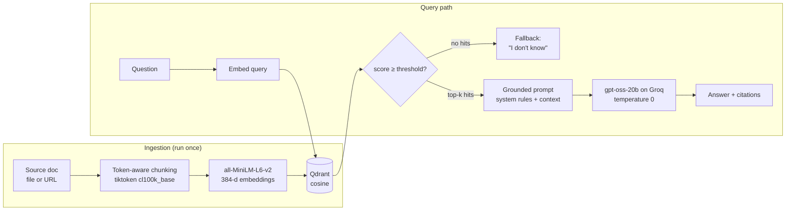

# grounded-rag-qa

Retrieval-augmented Q&A that answers **only from your documents** and says so when it can't. Built with LangChain, Qdrant, Hugging Face sentence embeddings and Groq.



## Why the score threshold matters

Top-k retrieval has no concept of "no answer": nearest neighbours always exist, so a plain retriever hands the LLM `k` chunks even for questions the corpus can't answer. Measured on the sample document with `grounded-rag search` (top-1 cosine similarity):

| Question | Top score | Kind |
|---|---|---|
| How many casual leaves am I entitled to? | 0.702 | answerable |
| What is the notice period for Band 4 employees? | 0.621 | answerable |
| Can I work remotely? | 0.427 | answerable |
| What is the stock option policy? | 0.290 | not in the document |
| What is the capital of France? | 0.057 | off-topic |
| asdf banana rocket | 0.069 | junk |

A floor of `0.3` separates the two groups. When nothing passes it, the chain returns the fallback **without calling the LLM**, which saves a round trip and removes any chance of an answer built from unrelated context. Tune it for your own corpus with the `search` command.

## Design

| Concern | Choice |
|---|---|
| Chunking | `RecursiveCharacterTextSplitter.from_tiktoken_encoder`: splits on paragraph → line → word boundaries, length counted in tokens. 128-token chunks keep well under MiniLM's 256 word-piece input limit, so nothing gets silently truncated at embed time. |
| Embeddings | `all-MiniLM-L6-v2`, runs locally on CPU, 384 dimensions, no API cost |
| Vector store | Qdrant with cosine distance. Embedded local mode by default; set `QDRANT_URL` for a server. Re-ingesting recreates the collection, so it's idempotent. |
| Retrieval | Top-k (default 5) with a similarity floor (`score_threshold`) |
| Generation | System-level grounding rules: use only the numbered passages, cite them, otherwise return a fixed fallback string. `gpt-oss-20b` on Groq at temperature 0. |
| Composition | LangChain Runnables: `RunnableParallel(docs=retriever, question=passthrough) → answer step`. The retriever, prompt and model are each swappable. |

## Quickstart

Requires Python 3.12+ and [uv](https://docs.astral.sh/uv/).

```bash
git clone https://github.com/harshakumargh/grounded-rag-qa.git
cd grounded-rag-qa
uv sync
cp .env.example .env          # add your GROQ_API_KEY
```

```bash
# 1. Index a document (defaults to the sample policy document)
uv run grounded-rag ingest
uv run grounded-rag ingest --source path/to/your_doc.md

# 2. Ask questions
uv run grounded-rag ask "How many casual leaves am I entitled to?"
uv run grounded-rag ask "What is the stock option policy?" --show-context

# 3. Inspect raw retrieval scores (no LLM call)
uv run grounded-rag search "Can I work remotely?"
```

`search` output:

```
+ 0.427  ### Remote and Hybrid Work AtliqAI follows a hybrid work model. Employees are expected to
- 0.197  --- ## Data Privacy & Confidentiality ### Employee Data AtliqAI collects and processes emp
- 0.183  ### Data Breach Reporting Any employee who becomes aware of a potential data breach or una

(+ passes the 0.3 threshold, - is filtered out)
```

## Project layout

```
src/grounded_rag/
  config.py   settings from env / .env
  ingest.py   load a file or URL, token-aware chunking
  store.py    embeddings + Qdrant indexing / reopening
  chain.py    retriever with threshold, grounded prompt, Runnable chain, fallback
  cli.py      ingest | ask | search
tests/        offline tests (fake embeddings, in-memory Qdrant, fake chat model)
notebooks/    walkthrough of the pipeline step by step
```

## Tests

```bash
uv run pytest
```

They run fully offline, with no API key or model download, and cover the token budget per chunk, threshold filtering in Qdrant, the no-LLM fallback path and the grounded answer path.

## Limitations

- Citations point to passage numbers, not section names.
- Dense retrieval only, so exact-keyword queries (IDs, codes) can be missed.
- The threshold is corpus- and model-specific, so re-measure it with `search` when either changes.

Sample document: a fictional company policy from [tnahddisttud/sample-doc](https://github.com/tnahddisttud/sample-doc).
